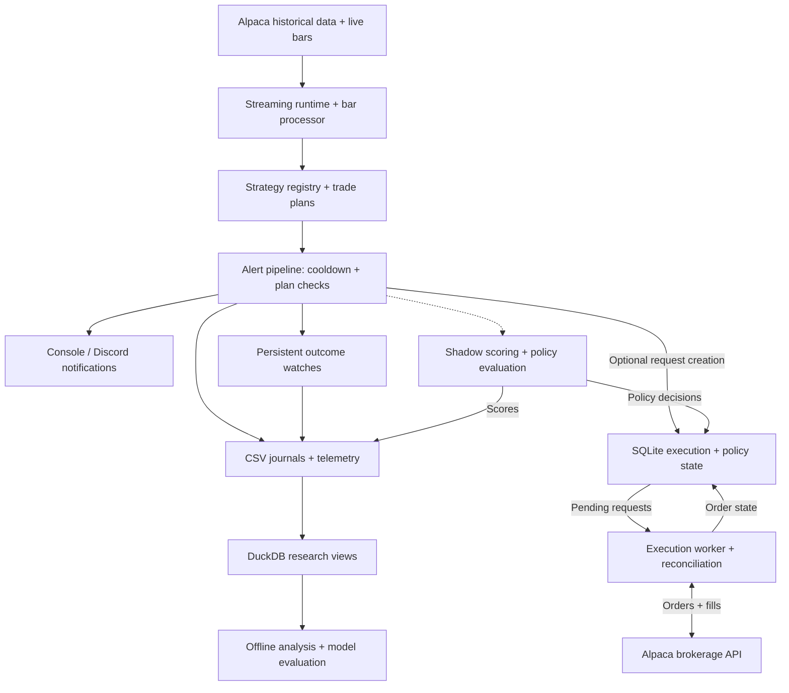

# Trade Scout

An event-driven trading research system built in Python. Trade Scout processes live stock or cryptocurrency market data, evaluates strategy candidates, tracks their outcomes, and turns the resulting data into a foundation for offline analysis. An optional execution subsystem connects trade plans to Alpaca's brokerage API.

This personal project brings together streaming data, stateful application design, durable execution workflows, and research tooling. Its focus is the engineering loop from **market observation → strategy evaluation → recorded outcomes → analysis**.

**Core technologies:** Python · Alpaca · SQLite · DuckDB · pandas · NumPy · scikit-learn · Cloudflare R2 · Render

## What the system does

- **Processes live market data:** consumes Alpaca WebSocket bars for a configured stock or crypto universe, with historical warmup and reconnection handling.
- **Evaluates trading strategies:** uses a strategy registry and typed candidate/trade-plan contracts. The current implementation includes a long breakout continuation strategy with market-specific profiles.
- **Tracks signals over time:** sends console or Discord alerts and persists watches that follow hypothetical trade outcomes as new bars arrive.
- **Supports optional broker execution:** uses a SQLite-backed request queue, validation, order reconciliation, and staged exit management.
- **Builds a research dataset:** records structured CSV journals and telemetry, then loads them into DuckDB for cohort, threshold, excursion, temporal stability, and execution analysis.
- **Evaluates experiments alongside the baseline:** records alternative scores and policy decisions in shadow mode for later comparison.

## Architecture

The live application runs as a single Python background worker. Streaming, scheduled maintenance, and the optional execution loop share that runtime; they are not separate deployed services.



Three distinctions help explain the data flow:

- **Outcome watches and broker executions measure different things.** Watches follow hypothetical trade paths derived from market bars. The execution subsystem records submitted orders and observed fills separately.
- **Shadow evaluations are observational.** Scores are recorded in CSV journals and policy decisions in SQLite; they do not gate alerts or execution.
- **Research depends on collected data.** DuckDB views are built from runtime journals. A fresh checkout does not include a trading dataset or precomputed results.

Scheduled maintenance handles research refreshes, snapshots, and optional backups to Cloudflare R2.

## Engineering design

| Area | Design approach |
| --- | --- |
| Streaming reliability | Explicit WebSocket lifecycle management, retry backoff, cooldown handling, and duplicate-start protection. |
| Strategy extensibility | A shared strategy protocol, registry-based loading, typed trade plans, and versioned strategy metadata. |
| Traceability | Stable alert identifiers, configuration and parameter hashes, structured journals, and persisted watch state. |
| Execution durability | SQLite request claiming, stale-request checks, duplicate-order recovery, and reconciliation against broker state. |
| Experimentation | Shadow policies and scoring recipes evaluated alongside the baseline, with offline model evaluation and temporal splits. |
| Verification | Unit and integration-style tests covering stream control, strategy behavior, persistence, execution, and research calculations. |

## Local setup

### 1. Install the runtime

Use **Python 3.11** to match the deployment configuration, and an Alpaca account with paper-trading API credentials.

```bash
git clone https://github.com/dvale94/trade-scout.git
cd trade-scout

python3.11 -m venv .venv
source .venv/bin/activate
python -m pip install -r requirements.txt
```

On Windows, create the environment with `py -3.11 -m venv .venv` and activate it with `.venv\Scripts\Activate.ps1` in PowerShell.

### 2. Configure a first run

Create a `.env` file in the repository root. The application loads it automatically.

```dotenv
ALPACA_API_KEY=your_paper_api_key
ALPACA_SECRET_KEY=your_paper_secret_key
ALPACA_BASE_URL=https://paper-api.alpaca.markets

MARKET_TYPE=crypto
STRATEGY_PROFILE=crypto_v1
SYMBOLS=BTC/USD,ETH/USD

EXECUTION_ENABLED=false
AUTO_EXECUTION_MODE=OFF
```

This configuration collects market data, evaluates strategies, and tracks outcomes with broker execution disabled. The application otherwise defaults `EXECUTION_ENABLED` to `true`, so keep the explicit setting for an initial run.

For stocks, use `MARKET_TYPE=stocks`, `STRATEGY_PROFILE=stocks_v1`, and symbols such as `AAPL,MSFT`. `ALPACA_STOCK_FEED` defaults to `iex`; choose a feed available to your Alpaca account.

Keep credentials in local environment variables or your hosting provider's secret settings. `.env` files are excluded from version control.

### 3. Start the worker

Run from the repository root:

```bash
python -m trade_scout.main
```

At startup, the worker seeds historical bars, restores persisted watches, starts maintenance tasks, and connects to the market stream. Alerts depend on market activity and strategy conditions; a successful connection does not imply an immediate signal.

### Optional configuration

| Setting | Purpose |
| --- | --- |
| `DISCORD_WEBHOOK_URL` | Send notifications to Discord. Without it, notifications print to the console. |
| `LOG_DIR` | Location for runtime journals and telemetry; defaults to `logs`. |
| `DUCKDB_PATH` | Research database location; defaults to `logs/research.duckdb`. |
| `EXECUTION_DB_PATH` | SQLite execution state location; defaults to `./execution.db`. |
| `R2_ENDPOINT_URL`, `R2_ACCESS_KEY_ID`, `R2_SECRET_ACCESS_KEY`, `R2_BUCKET` | Configure remote backups. `R2_PREFIX` optionally namespaces stored objects. |

R2 is optional for streaming and alerts. Scheduled backup attempts report configuration errors until R2 is configured.

See [`trade_scout/config.py`](trade_scout/config.py) for runtime settings and [`trade_scout/strategy_profiles.py`](trade_scout/strategy_profiles.py) for the market profiles.

## Research workflow

The research layer connects recorded signals to measurable questions: how results vary across cohorts, how thresholds affect candidate selection, how trade paths evolve, and how execution differs from hypothetical outcomes.

After the runtime has collected alert journals, install the research dependencies and build the analytical database:

```bash
python -m pip install -r requirements-research.txt
python scripts/build_research_duckdb.py
```

The database builder requires the relevant `logs/<market>_alerts_intents.csv` file, such as `logs/crypto_alerts_intents.csv`. Run it after collecting data rather than immediately after cloning.

Analysis modules live in [`research/`](research/). Modeling, temporal splits, prediction artifacts, and evaluation utilities live in [`research/scoring/`](research/scoring/). Generated notebooks and local datasets are excluded from the repository.

## Testing

Install both dependency sets to run the full suite, including research tests:

```bash
python -m pip install -r requirements.txt -r requirements-research.txt
python -m unittest discover -s tests -v
```

The suite uses Python's `unittest` framework, mocked broker/API interactions, and temporary databases to exercise runtime behavior and analytical calculations.

## Deployment

[`render.yaml`](render.yaml) defines a Python background worker with the same installation and entry-point commands used locally.

To deploy on Render:

1. Before the first worker starts, set `EXECUTION_ENABLED=false` and `AUTO_EXECUTION_MODE=OFF` in the deployment configuration. The Blueprint currently sets `EXECUTION_ENABLED=true`.
2. Create the worker from the repository's Blueprint and supply the account credentials, market settings, and symbols requested by the configuration.
3. Attach a persistent disk at `/var/data`. The configured log, database, and backup-state paths use that mount; the YAML does not provision the disk itself.
4. Configure R2 credentials if you want remote backups, then inspect worker logs to verify streaming and maintenance behavior.

When exploring broker execution, retain the paper endpoint and paper-account credentials. `ALPACA_BASE_URL` is configurable; the application does not enforce a paper-only endpoint.

## Repository guide

| Path | Responsibility |
| --- | --- |
| [`trade_scout/main.py`](trade_scout/main.py) | Runtime startup, streaming orchestration, and lifecycle management. |
| [`trade_scout/strategies/`](trade_scout/strategies/) | Strategy contracts, registry, and implementations. |
| [`trade_scout/alert_pipeline.py`](trade_scout/alert_pipeline.py) | Signal processing, journaling, notifications, and execution-request creation. |
| [`trade_scout/watch.py`](trade_scout/watch.py) | Persistent monitoring of hypothetical trade outcomes. |
| [`trade_scout/execution/`](trade_scout/execution/) | Request queue, broker integration, execution worker, and reconciliation. |
| [`trade_scout/policy/`](trade_scout/policy/) and [`trade_scout/scoring/`](trade_scout/scoring/) | Runtime shadow policy and scoring evaluation. |
| [`research/`](research/) | Offline analysis, model evaluation, and research utilities. |
| [`scripts/`](scripts/) | Research database builds, execution checks, and backup/restore tooling. |
| [`tests/`](tests/) | Runtime, execution, persistence, and research tests. |
